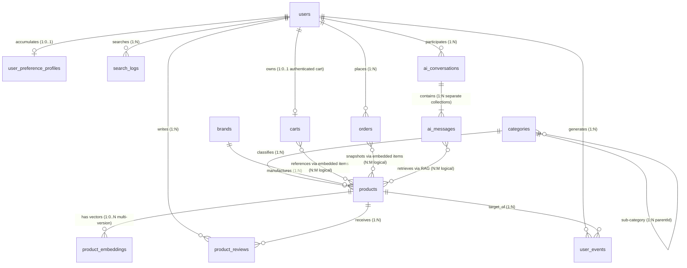
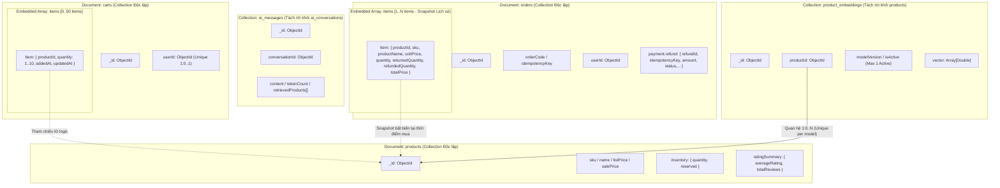

# Database Specification v1.2.1: Sơ đồ Quan hệ Logic giữa các Collections (Relationship Diagrams)
**Dự án:** Smart E-commerce AI  
**Vai trò:** Senior Database Architect  
**Phiên bản:** 1.2.1 (Technical Consistency & Refinement Edition)  
**Ngày cập nhật:** 15/11/2026  

---

> [!IMPORTANT]
> **Lưu ý kiến trúc cốt lõi:**  
> Trong MongoDB (Document Database), không tồn tại ràng buộc khóa ngoại vật lý (Physical Foreign Key Constraint) như trong hệ quản trị cơ sở dữ liệu quan hệ (RDBMS). Toàn bộ các quan hệ dưới đây là **Quan hệ Logic cấp Ứng dụng (Logical Application-level Relationships)** được kiểm soát và duy trì tính toàn vẹn thông qua tầng Application/Service (Spring Boot và FastAPI) kết hợp với các cơ chế nhúng (Embedding) và tham chiếu (Referencing qua `ObjectId`).

---

## 1. Sơ đồ Thực thể Quan hệ Cấp Collection (Collection-Level ER Diagram)

Biểu đồ dưới đây **chỉ biểu diễn các MongoDB Collection thực sự tồn tại vật lý** trong hệ thống (14 Collections). Các thành phần con như mảng item trong giỏ hàng hoặc chi tiết hóa đơn là các subdocuments nhúng trực tiếp, không được mô hình hóa thành collection độc lập.



---

## 2. Sơ đồ Cấu trúc Document & Phân định Nhúng Subdocument (Embedded Subdocument Mapping)

Nhằm phân định rõ ràng giữa **Tài liệu Nhúng (Embedded Subdocument)** và **Collection Vật lý Độc lập (Separate Physical Collections)**, sơ đồ dưới đây mô tả chi tiết ranh giới lưu trữ và cardinality thực tế:



### Quy định Cardinality và Cơ chế Nhúng:
1. **`carts.items` (Mảng Giỏ hàng Nhúng):**
   - **Cardinality: $0 \ldots 50$ items.** Giỏ hàng của người dùng khi mới khởi tạo hoàn toàn có thể rỗng ($0$ items).
   - Mỗi sản phẩm chỉ xuất hiện tối đa $1$ lần trong mảng `items`. Nếu thêm tiếp sản phẩm đã có, hệ thống cập nhật `quantity` (giới hạn $1 \ldots 10$).
   - Không tạo collection `cart_items` riêng biệt nhằm tối ưu tốc độ đọc/ghi nguyên tử trong 1 document.
2. **`orders.items` (Mảng Hóa đơn Nhúng - Historic Snapshot):**
   - **Cardinality: $1 \ldots N$ items.** Một đơn hàng hợp lệ bắt buộc phải có ít nhất $1$ item.
   - Nhúng toàn bộ thông tin giá bán, SKU, tên và ảnh snapshot tại thời điểm thanh toán. Dữ liệu này bất biến kể cả khi sản phẩm gốc bị đổi tên hoặc đổi giá.
   - Quản lý trả hàng và hoàn tiền từng phần bằng hai trường số nguyên: `returnedQuantity` ($0 \le returnedQuantity \le quantity$) và `refundedQuantity` ($0 \le refundedQuantity \le quantity$).
3. **Phân biệt với Collection Độc lập:**
   - `ai_conversations` và `ai_messages` là **2 collections vật lý riêng biệt** để tránh vi phạm giới hạn kích thước document 16MB của MongoDB khi cuộc trò chuyện kéo dài (Unbounded Growth Pattern).
   - `product_embeddings` và `product_reviews` là **các collections riêng biệt** với `products` để không làm nặng document sản phẩm khi thực hiện truy vấn OLTP thông thường.

---

## 3. Ma trận Quan hệ Chi tiết (Relationship Matrix)

| Thực thể A | Thực thể B | Loại quan hệ | Cơ chế triển khai | Ràng buộc & Toàn vẹn dữ liệu |
| :--- | :--- | :---: | :--- | :--- |
| `categories` | `categories` | `1:N` | Tham chiếu qua `parentId` | Hỗ trợ danh mục cha - con đa cấp. Root category có `parentId = null`. |
| `categories` | `products` | `1:N` | Tham chiếu qua `categoryId` | Kèm theo Denormalized `categorySlug` trong `products` để tăng tốc độ truy vấn filter. |
| `brands` | `products` | `1:N` | Tham chiếu qua `brandId` | Kèm theo Denormalized `brandName` trong `products`. |
| `products` | `product_embeddings` | **`1:0..N`** | Tham chiếu qua `productId` | **Hỗ trợ đa phiên bản:** Một sản phẩm có thể có nhiều vector theo các `modelVersion` khác nhau (Unique Index `{ productId, modelVersion }`). **Bảo đảm tối đa 1 active:** Partial Unique Index `{ productId: 1 }` với `{ isActive: true }`. |
| `products` | `product_reviews` | `1:N` | Tham chiếu qua `productId` | Một sản phẩm có nhiều đánh giá. Mỗi user chỉ có 1 review hoạt động cho mỗi sản phẩm (Partial Unique Index hỗ trợ soft-delete). |
| `users` | `carts` | `1:0..1` | Tham chiếu qua `userId` | Mỗi tài khoản đã đăng nhập có tối đa một giỏ hàng chủ động. Khách chưa đăng nhập không có giỏ hàng (Authentication Required). Không áp dụng TTL Index hết hạn. |
| `users` | `orders` | `1:N` | Tham chiếu qua `userId` | `userId` được index trong `orders` để tìm lịch sử mua hàng của khách. |
| `users` | `user_events` | `1:N` | Tham chiếu qua `userId` | Sự kiện hành vi ghi nhận `userId` (hoặc `sessionId` nếu khách chưa đăng nhập). |
| `users` | `user_preference_profiles` | **`1:0..1`** | Tham chiếu qua `userId` | Hồ sơ sở thích người dùng tích lũy dài hạn sau quá trình Roll-up Aggregation (chỉ sinh ra sau khi user có đủ dữ liệu hành vi). |
| `ai_conversations` | `ai_messages` | `1:N` | Tham chiếu qua `conversationId` | Tách rời 2 collections để tránh vi phạm giới hạn kích thước document (Unbounded Array Pattern). |
| `ai_messages` | `products` | `N:M` | Tham chiếu nhúng qua mảng `retrievedProducts` | Lưu danh sách các sản phẩm được thuật toán RAG trích xuất làm ngữ cảnh trả lời. |

---

## 4. Phân tích Chi tiết Quan hệ Trọng yếu Đã Điều chỉnh

### 4.1. Đa Phiên bản Embedding & Ràng buộc Tối đa Một Embedding Active
- **Quan hệ `1:0..N` (One to Zero-or-Many):** Cho phép lưu trữ đồng thời Model V1 và Model V2 phục vụ Zero-downtime Migration.
- **Bảo đảm Tối đa 1 Active:** Bổ sung Partial Unique Index:
  ```javascript
  db.product_embeddings.createIndex(
    { productId: 1 },
    { unique: true, partialFilterExpression: { isActive: true }, name: "uniq_active_embedding_per_product" }
  );
  ```
  Ngăn chặn hoàn toàn lỗi tranh chấp đồng thời khi switch model, loại bỏ nguy cơ một sản phẩm có 2 vector active cùng lúc.

### 4.2. Đồng nhất Quan hệ `users` $\leftrightarrow$ `user_preference_profiles` thành `1:0..1`
- Tài khoản mới tạo chưa có hồ sơ sở thích. Document này chỉ sinh ra sau khi tiến trình Roll-up phân tích đủ dữ liệu tương tác của người dùng.

### 4.3. Giỏ hàng Yêu cầu Xác thực & Bền vững (No TTL)
- Thay thế hoàn toàn phương án Guest Cart / Cart Merge.
- Chỉ người dùng đã đăng nhập mới được tạo giỏ hàng (Quan hệ logic `users` $\rightarrow$ `carts` là **`1:0..1`**).
- Khách vãng lai chỉ xem, tìm kiếm và lọc sản phẩm. Khi nhấn "Thêm vào giỏ", hệ thống yêu cầu đăng nhập.
- Loại bỏ hoàn toàn `cartType`, `sessionId` khỏi collection `carts`, loại bỏ trường `expiresAt` và TTL Index 30 ngày (do chính sách tự động xóa chưa được phê duyệt).

---

## 5. Chiến lược Denormalization & Đồng bộ Dữ liệu Phi chuẩn hóa

- **`categorySlug` và `brandName` trong `products`:** Giúp các truy vấn lọc danh mục và thương hiệu diễn ra tức thì trên compound index của `products` mà không cần lookup. Khi có thay đổi tên thương hiệu hoặc slug, Background Job thực hiện `updateMany` hàng loạt và đánh dấu vector liên quan là `OUTDATED`.
- **`ratingSummary` trong `products`:** Lưu điểm sao trung bình và số lượng đánh giá. Hỗ trợ cập nhật gia số khi duyệt lẻ và hỗ trợ **Atomic Recompute** qua Aggregation Pipeline khi duyệt hàng loạt nhằm chống race condition.
